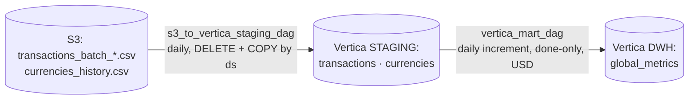

## Выпускной проект: DWH транзакционной активности финтех-стартапа

> **Студент:** `s14905573` 
> **Период данных:** октябрь 2022 
> **Стек:** Airflow · Python (boto3, psycopg2) · S3 (Object Storage) · PostgreSQL (dev-стенд) · Vertica (прод)

## Суть проекта

Финальный проект курса: построение послойного DWH для финтех-стартапа. Источник - сырые батчи транзакций и справочник курсов валют в S3. На выходе - готовая для отчётов бизнесу витрина `global_metrics` с ежедневной агрегацией оборотов по валютам выраженных в USD.

## Архитектура

```
S3 (Object Storage)
  │
  │  DAG №1: s3_to_staging_dag (ежедневно, идемподентно: DELETE + INSERT по {{ ds }})
 \/
staging.transactions   (сырые события: queued / in_progress / done / chargeback / blocked)
staging.currencies     (кросс-курсы валют на дату)
  │
  │  DAG №2: staging_to_mart_dag (инкремент за день: DELETE + INSERT по дню)
 \/
dwh.global_metrics     (итоговая витрина)
```

Оба DAG идемподентны: повторный запуск за любую дату даёт идентичный результат. Бэкфилл за весь октябрь 2022 (31 `run` на каждый DAG) в итоге полностью в зелёном статусе.

## Источник: почему S3

ТЗ предлагало три варианта источника - S3, PostgreSQL и Kafka. Выбор пал на **S3**, и это не только вопрос вкуса, но и суровая реальность инфраструктуры платформы в этом потоке:

- **Managed PostgreSQL** (`rc1b-w5d285tmxa8jimyn.mdb.yandexcloud.net:6432`) был недоступен весь период активной работы: хост просто не резолвился в DNS ни с хоста, ни из контейнера. Инстанс отвалился вместе с недоступной зоной платформы.
- **Kafka** потребовала бы регистрации через `order-gen-service.de.education-services.ru` (домен той же недоступной зоны), поднятия собственной инфраструктуры и стриминговой логики. Для детерминированного бэкфилла исторического месяца это неоправданно: сложность возрастает, а выигрыш минимален.
- **S3** (`storage.yandexcloud.net/final-project`) был доступен с первого дня. 10 батчей транзакций + справочник курсов, ключи из методички, чтение через `boto3`. Данные во всех источниках по ТЗ идентичны, поэтому выбор S3 ничего не теряет, а батчевая структура позволяет обрабатывать файлы итеративно.

## Архитектурные решения и договорённости

Пара слов про то, что считать «истиной» при расчёте метрик:

| Решение                                                                          | Почему именно так                                                                                                                                                         |
| -------------------------------------------------------------------------------- | ------------------------------------------------------------------------------------------------------------------------------------------------------------------------- |
| **Staging хранит сырой событийный лог** (без дедупликации по статусу)            | Разные статусы одной операции (`queued` → `in_progress` → `done`) — это разные события. Стейджинг не должен заниматься бизнес-логикой, он хранит факт поступления строки. |
| **Витрина считает только `status = 'done'`**                                     | Только завершённые операции дают бизнес-смысл обороту. `chargeback` и `blocked` — это анти-метрики,  имхо, их аналитики должны смотреть отдельно.                         |
| **`account_number_from < 0` отбрасываются**                                      | Это тестовые/служебные аккаунты, их транзакции не должны портить продуктовую метрику.                                                                                     |
| **Конвертация в USD:** `amount × currency_with_div` пары `(currency_code → 420)` | Так устроен справочник: 420 = USD, `currency_with_div` — это множитель для пересчёта.                                                                                     |
| **Для `currency_from = 420` курс принят равным 1** (`COALESCE(rate, 1)`)         | В справочнике нет собственных пар (420→420), поэтому `INNER JOIN` отбрасывал долларовые транзакции. Курс «USD→USD = 1» — единственно логичный дефолт.                     |
| **`amount / 100.0`**                                                             | Суммы в источнике лежат в минимальных единицах валюты (копейки/центы).                                                                                                    |
| **Идемподентность через `DELETE + INSERT` по `{{ ds }}`**                        | Проще и быстрее, чем городить `MERGE/UPSERT`, а на объёмах стейджинга этого более чем достаточно.                                                                         |

## Грабли, которые пришлось собрать

Проект получился максимально «боевым»: инфраструктура жила своей жизнью, поэтому без костылей и дебага не обошлось.

1. **UniqueViolation в staging.** Сначала сделал PK `(operation_id, transaction_date)`. Оказалось, что `operation_id` — это ID самой операции, по которой в день приходит несколько событий (статусы меняются). Решение: убрал PK, оставил событийную гранулярность, а идемподентность обеспечил на уровне DAG через `DELETE` по дате.
2. **Выпадение USD из витрины.** `INNER JOIN` с `currencies` молча отбрасывал сторки, где `currency_code = 420`. Решение: `LEFT JOIN` + `COALESCE(rate, 1)`.
3. **«Пустые» дни октября.** Сперва казалось, что конвейер теряет данные. Оказалось, **генератор данных на стороне платформы работал рывками**: транзакции есть только за 15 дней (01, 05, 06, 08, 09, 10, 11, 18, 19, 20, 21, 23, 24, 25 и 31 числа октября). Скрипт `check_source_dates.py` это подтверждает. Кстати, в `batch_10` есть «хвост» за `2022-11-01`: по ТЗ период проекта — октябрь, поэтому этот день в стейджинг сознательно не загружался.
4. **Таймауты Airflow при чтении S3.** В логах бэкфилла `s3_to_staging_dag` можно заметить, что батчи за 1, 5, 8, 9 и 10 октября сначала падали (задачи висели по 10-15 минут и отваливались). `boto3` не вывозил чтение тяжёлых CSV за дефолтное время в условиях ограниченного Docker-окружения. Пришлось добавить ретраи и поиграть с параметрами чтения, после чего всё встало в зелёный статус.
5. **Нюансы с инфраструктурой платформы.** Vertica (`vertica.data-engineer.education-services.ru:5433`) была недоступна почти всё время работы. Решение: вся разработка и обкатка логики сделаны на локальном PostgreSQL-дублёре из Docker-образа. DDL для Vertica (с проекциями и сегментированием `HASH(date, operation_id)`) был готов заранее и ждал восстановления кластера.

## Верификация

Чтобы доказать корректность витрины, я делал контрольный пересчёт «в лоб» из стейджинга и сравнивал с результатами DAG. Пример для `2022-10-20` (один из самых «плотных» дней):

```PostgreSQL
-- Витрина:
SELECT 
	currency_from, 
	amount_total, 
	cnt_transactions, 
	cnt_accounts_make_transactions
FROM dwh.global_metrics 
WHERE date_update = DATE '2022-10-20';

-- Контрольный запрос (та же логика, что в DAG):
SELECT 
	t.currency_code AS currency_from,
    SUM(t.amount * COALESCE(r.currency_with_div, 1)) / 100.0 AS amount_total,
    COUNT(*) AS cnt_transactions,
    COUNT(DISTINCT t.account_number_from) AS cnt_accounts_make_transactions
FROM 
	staging.transactions t
	LEFT JOIN staging.currencies r
		ON r.currency_code = t.currency_code
		AND r.date_update  = t.transaction_date
		AND r.currency_code_with = 420
WHERE 
	t.transaction_date = DATE '2022-10-20'
	AND t.status = 'done'
	AND t.account_number_from >= 0 
	AND t.account_number_to >= 0
GROUP BY 1 
ORDER BY 1;
```

Результаты сходятся **до копейки** (например, по 410: `8 055 809.00`, 6 053 транзакции, 626 аккаунтов — идентично в обоих выборках). Скриншоты сверки лежат в `docs/`.

## Структура репозитория

```
de-final-project/
├── dags/
│   ├── s3_to_staging_dag.py			# S3 → staging (ежедневно)
│   ├── s3_to_vertica_staging_dag.py		# Verticaq → staging (ежедневно)
│   ├── vertica_mart_dag.py			# Vertica → dwh.global_metrics (ежедневно)
│   └── staging_to_mart_dag.py			# staging → dwh.global_metrics (ежедневно)
├── data_samples/
│   ├── transactions_sample.csv
│   └── currencies_sample.csv
├── docs/					# Скриншоты сверок, Grid Airflow, схема DWH
│   ├── 01_airflow_grid_s3_to_staging.png
│   ├── 02_airflow_grid_staging_to_mart.png
│   ├── 03_airflow_graph.png
│   ├── 04_staging_volumes.png
│   ├── 05_mart_sample.png
│   ├── 06_verification_mart_vs_control.png
│   ├── 07_source_dates.png
│   ├── 08_vertica_mart_part1.png
│   ├── 08_vertica_mart_part2.png
│   └── project_brief.docx
├── sql/
│   ├── local_dwh_ddl.sql			# DDL для локального PostgreSQL (staging + dwh)
│   └── vertica_ddl.sql			# DDL для Vertica (с проекциями и HASH-сегментированием)
├── check_source_dates.py			# Проверка: какие даты реально есть в S3
├── s3_recon.py				# Разведка источников
└── README.md
```

## Как запустить (Dev-стенд на PostgreSQL)

```
# 1. Запустить контейнер
docker run -d -p 8998:8998 -p 8280:8280 -p 15432:5432 \
  --name=de-final-prj-local cr.yandex/crp1r8pht0n0gl25aug1/de-final-prj:latest

# 2. Поднять схему (из контейнера)
docker exec -it de-final-prj-local psql -U jovyan -d de -f /lessons/sql/local_dwh_ddl.sql

# 3. Backfill за весь октябрь 2022
docker exec -it de-final-prj-local \
  airflow dags backfill s3_to_staging_dag -s 2022-10-01 -e 2022-10-31
docker exec -it de-final-prj-local \
  airflow dags backfill staging_to_mart_dag -s 2022-10-01 -e 2022-10-31

# 4. UI Airflow: http://localhost:8280/airflow/
# 5. Подключение к БД: host=localhost port=15432 dbname=de user=jovyan password=jovyan
```

> **Учётные данные:** Ключи S3 не хардкодятся в коде, а задаются через `airflow variables set s3_access_key / s3_secret_key`.

## Статус по Vertica (upd на ноябрь 2026)

30.10.2026 платформа наконец восстановила доступ к кластеру Vertica. До этого момента весь dev- и verification-контур крутился на локальном PG, что позволило не блокировать разработку и полностью отладить SQL-логику. На данный момент:

1. Развёрнуты схемы `VT2608212D19C6__STAGING` и `VT2608212D19C6__DWH`.
2. Создана витрина `VT2608212D19C6__DWH.global_metrics` с нужными проекциями.
3. Успешно прогнаны бэкфиллы 31/31 по "вертикальным" DAGам (`s3_to_vertica_staging_dag` и `vertica_mart_dag`).
4. Данные в Vertica сверены с PG-стендом — полное совпадение.

PG-стенд оставлен в репозитории как dev-контур и исторический артефакт периода недоступности платформы. Продуктовый контур — Vertica.

## Архитектура (Prod)


